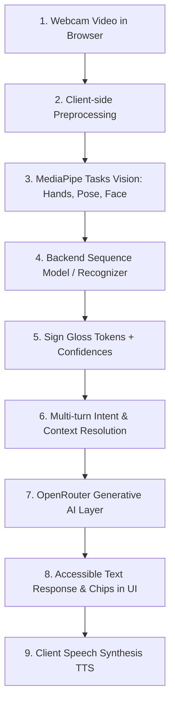

# SignBridge AI Architecture

## 9-Stage Multimodal Pipeline

## Privacy Boundary
- **Client (Browser):** Camera capture, MediaPipe inference, audio synthesis.
- **Backend Server (FastAPI):** Feature normalization, sequence classification, session memory.
- **External Cloud (OpenRouter):** Text-only intent interpretation and response generation.
