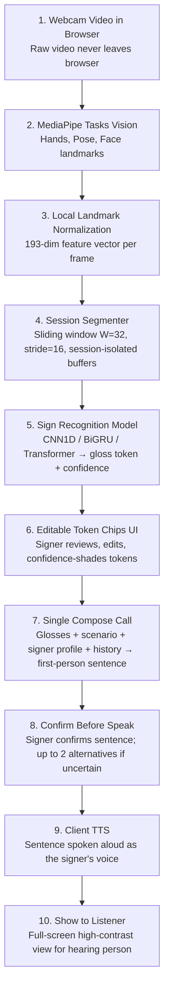

# SignBridge AI Architecture

## One-Way Compose Pipeline (Part A)

## Privacy Boundary (Invariant C)
- **Client (Browser):** Camera capture, MediaPipe inference, TTS audio synthesis. Raw video never leaves the browser.
- **Backend Server (FastAPI):** Feature normalization, sequence classification, session memory (signer-only turns), Compose LLM call.
- **External Cloud (OpenRouter):** Text-only — receives plain English prompt (glosses + scenario + profile), returns a JSON sentence. No video, no audio, no PII.

## Data Flow (Invariant A — One-Way Only)
1. Signer produces hand gestures + facial expressions.
2. Browser captures landmarks via MediaPipe Tasks Vision; streams to backend over WebSocket.
3. Backend segments frames into windows, recognizes sign gloss tokens with confidence.
4. Frontend presents tokens as editable chips; signer reviews/edits before composing.
5. One Compose call turns glosses into a first-person sentence spoken AS the signer.
6. Signer confirms the sentence before it is spoken (confirm ON by default; auto-speak OFF).
7. TTS speaks the sentence; it is added to spoken history; optionally shown full-screen to the listener.

## No Assistant Turns
- The system is NOT a chatbot. There are no assistant replies, no quick replies, no emergency/medical alerts, and no hearing-person speech-to-text.
- Memory stores only the signer's composed sentences (one-way memory).