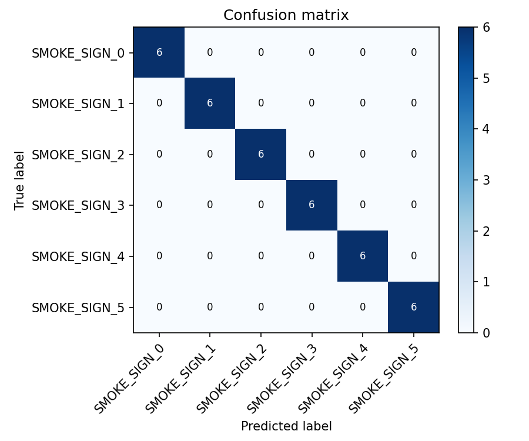

# ISL Sign Recognition — Evaluation Report

- **Data source:** ml/datasets/ (gitignored)
- **Test clips:** 36
- **Classes (6):** SMOKE_SIGN_0, SMOKE_SIGN_1, SMOKE_SIGN_2, SMOKE_SIGN_3, SMOKE_SIGN_4, SMOKE_SIGN_5
- **Device:** cpu (CPU)
- **Window:** 32 frames, 193-dim features

> **SMOKE TEST — NOT A RESULT**
>
> No real ISL data exists in ml/datasets/ yet. A tiny synthetic
> smoke dataset was generated ONLY to verify the pipeline runs.
> Metrics below are NOT real accuracy and must not be presented as such.

## Per-architecture results (full 193-dim features)

| Architecture | Top-1 Acc | Top-3 Acc | Model Size (MB) | Latency (ms/sign) | Checkpoint |
|---|---|---|---|---|---|
| cnn1d | 1.0000 | 1.0000 | 0.25 | 0.34 | ml\weights\cnn1d_best.pt |
| bigru | 1.0000 | 1.0000 | 0.67 | 1.02 | ml\weights\bigru_best.pt |
| transformer | 1.0000 | 1.0000 | 0.32 | 0.34 | ml\weights\transformer_best.pt |

## Per-class metrics — best architecture (cnn1d)

| Class | Precision | Recall | F1 |
|---|---|---|---|
| SMOKE_SIGN_0 | 1.000 | 1.000 | 1.000 |
| SMOKE_SIGN_1 | 1.000 | 1.000 | 1.000 |
| SMOKE_SIGN_2 | 1.000 | 1.000 | 1.000 |
| SMOKE_SIGN_3 | 1.000 | 1.000 | 1.000 |
| SMOKE_SIGN_4 | 1.000 | 1.000 | 1.000 |
| SMOKE_SIGN_5 | 1.000 | 1.000 | 1.000 |

## Confusion matrix

## Ablation — face features (full vs face-zeroed)

| Architecture | Top-1 (full) | Top-1 (no face) | Delta |
|---|---|---|---|
| cnn1d | 1.0000 | 1.0000 | +0.0000 |
| bigru | 1.0000 | 1.0000 | +0.0000 |
| transformer | 1.0000 | 1.0000 | +0.0000 |

### Velocity features

The current 193-dim feature spec does not include velocity features (hands/pose/face coordinates + presence masks only). Velocity ablation is deferred; adding velocity would change the input dimension and require retraining all architectures.

## Summary

> **SMOKE TEST — NOT A RESULT.** No real ISL data has been collected yet.
> Run the `/collect` page to record real sign clips, then re-run training/evaluation.